# Healthcare Expenditure and Life Expectancy Across Countries: An Extended Panel Data Analysis

**Data:** World Bank World Development Indicators (WDI), retrieved via API (health expenditure series originate in the WHO Global Health Expenditure Database)
**Period:** 2000–2023 · **Sample:** 186 countries, 4,404 country-years
**Reproduce:** run `Healthcare_Spending_Life_Expectancy.ipynb` (all numbers and figures below are generated by the notebook)

The section numbers of this report match the notebook's sections.

---

## 1. Research question and setup

How is healthcare expenditure associated with life expectancy across countries? Has this relationship changed over time? Does it hold after accounting for economic development (GDP per capita), financing structure (out-of-pocket share), nonlinearity and alternative model specifications? All results are **statistical associations, not causal effects**.

| Role | Indicator | Code |
|---|---|---|
| Main spending measure | Current health expenditure per capita, PPP (current intl $) | SH.XPD.CHEX.PP.CD |
| Alternative spending measure | Current health expenditure, % of GDP | SH.XPD.CHEX.GD.ZS |
| Financing structure | Out-of-pocket expenditure, % of current health expenditure | SH.XPD.OOPC.CH.ZS |
| Outcome | Life expectancy at birth (years) | SP.DYN.LE00.IN |
| Economic control | GDP per capita, PPP (constant 2021 intl $) | NY.GDP.PCAP.PP.KD |
| Secondary (comparison with earlier studies) | Health expenditure per capita, current US$ | SH.XPD.CHEX.PC.CD |
| Extension | Government / private share of health expenditure | SH.XPD.GHED.CH.ZS, SH.XPD.PVTD.CH.ZS |
| Extension outcomes | Under-5 mortality, maternal mortality | SH.DYN.MORT, SH.STA.MMRT |
| France–US context only (no models) | Gini index, overweight adults, tobacco use, population 65+, WHO UHC service coverage index | SI.POV.GINI, SH.STA.OWAD.ZS, SH.PRV.SMOK, SP.POP.65UP.TO.ZS, UHC_INDEX_REPORTED |

## 2. Data collection

The ten main indicators were downloaded for all economies for 2000–2025 from the World Bank API, together with country metadata (region, income group). Raw responses are cached in `data/raw/`, so the notebook runs offline. The five context indicators are downloaded the same way; the coverage index comes from the WHO Global Health Observatory API.

## 3. Preprocessing

Result tables are in `outputs/tables/preprocessing_*.csv`.

- **Aggregates removed.** 79 regional and income aggregates were dropped, leaving 217 economies.
- **Merge and uniqueness.** Records were merged on ISO3 code and year. There were 0 duplicate country-year-indicator records, and uniqueness was verified with an assertion.
- **Study window: 2000–2023.** Health expenditure covers 184–193 countries per year until 2023, but only 22 countries in 2024 (Fig. 1).
- **Missing values documented, never zero-filled or imputed.** Health expenditure series are about 12.8% missing and GDP 9.4%. Twenty-four economies have no health-expenditure data at all; they are mostly small territories, plus North Korea, Hong Kong, Macao and Kosovo. "Not classified" income group is treated as missing.
- **Validity checks:** percentages within 0–100, positive spending and GDP, government plus private share ≤ 100%, out-of-pocket share ≤ private share, and life expectancy within 20–95 years. Only 2 records failed: the Central African Republic's life expectancy of 14.7 years (2009) and 18.8 years (2022), both crisis years. Values this low can appear in UN estimates for years with mass deaths, but they fall outside the range set in advance, so they are flagged and **excluded from the analytic sample**.
- **Outliers flagged, not removed** (257 flags on 235 country-years, in `preprocessing_outliers.csv`):
  - Cross-sectional: robust z-score above 3.5 within each year, a commonly recommended cut-off (Iglewicz & Hoaglin, 1993). These include US health spending as % of GDP (12.5–18.5% over 2000–2023, flagged in 19 years), Tuvalu, the Marshall Islands and Nauru.
  - Year-on-year jumps: robust z above 8. This cut-off is a judgement call: yearly changes are usually tiny, so 3.5 would flag 852 country-years. The flags coincide with the Central African Republic's crises, Haiti in 2010, Somalia in 2011, and COVID-19 (99 of 146 life-expectancy jump flags fall in 2020–2022).
  - A robustness check re-estimates the models without the flagged rows (Section 6).
- **Analytic sample.** Country-years with all five core variables that passed the validity checks: 4,404 observations from 186 countries (21 low, 46 lower-middle, 57 upper-middle and 62 high income). A balanced sub-panel has 176 countries × 24 years.
- **Derived variables.** Logs of spending and GDP (skewness of spending falls from 2.3 to near 0; Fig. 2), period (2000–07, 2008–15, 2016–23), and a COVID dummy (2020–21).
- **Current vs constant prices.** Spending is in current international dollars and GDP in constant 2021 dollars. Inflation common to all countries is absorbed by year fixed effects; Section 6 checks the other models with spending rebuilt in constant dollars.

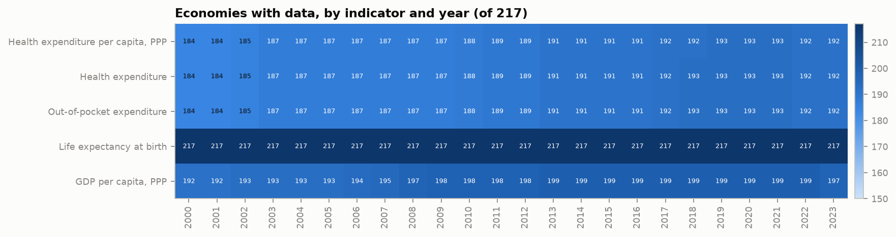
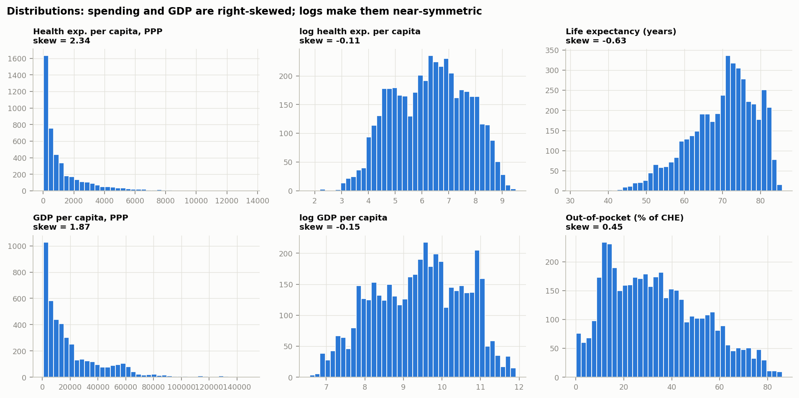

## 4. Exploratory analysis

Median values, all country-years:

| Income group | Life expectancy | Health exp. pc (PPP $) | Health exp. % GDP | OOP % of CHE |
|---|---|---|---|---|
| Low | 58.8 | 77 | 5.0 | 43.5 |
| Lower middle | 64.7 | 159 | 4.5 | 43.4 |
| Upper middle | 71.9 | 581 | 5.5 | 35.1 |
| High | 78.8 | 2,353 | 7.3 | 19.8 |

- **Spending varies far more than life expectancy.** Health spending per capita differs about 30-fold between low- and high-income groups. Life expectancy differs by about 20 years.
- **Everything improved over time.** Life expectancy rose in all income groups, with the fastest gains in low-income countries (median +11.6 years from 2000 to 2019, vs +5.1 in high-income countries). It fell during COVID-19, in 2020–21, then recovered (Fig. 3).
- **Patients pay a smaller share directly.** The median out-of-pocket share fell from 34.7% (2000–07) to 28.5% (2016–23).
- **Spending tracks life expectancy across countries.** The relationship is close to linear in **log** spending (Fig. 4). Pooled, life expectancy correlates r = 0.83 with log spending, r = 0.83 with log GDP, r = 0.63 with the government share and r = –0.33 with the OOP share. Spending and GDP correlate r = 0.94. Spending as % of GDP is only weakly correlated, at r = 0.29 (Fig. 6).
- **Out-of-pocket burden is highest in South Asia** (median about 49% in 2023) and lowest in East Asia & Pacific and North America (Fig. 5).

Interactive choropleth maps of spending, OOP burden and life expectancy are in `outputs/maps/`. The full explorer is `outputs/dashboard.html` (Section 9).

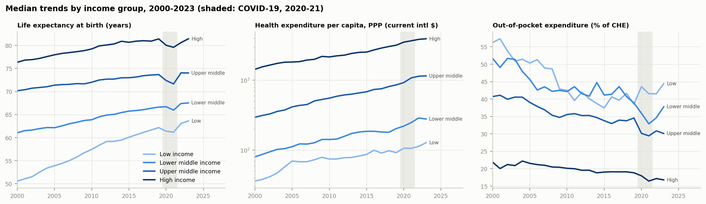
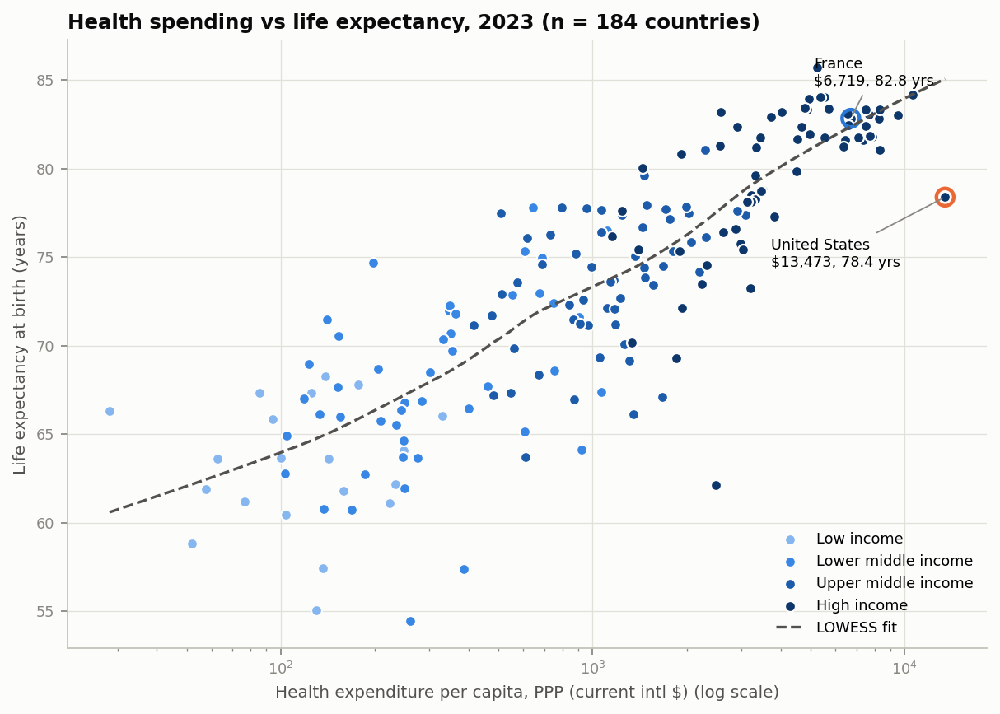
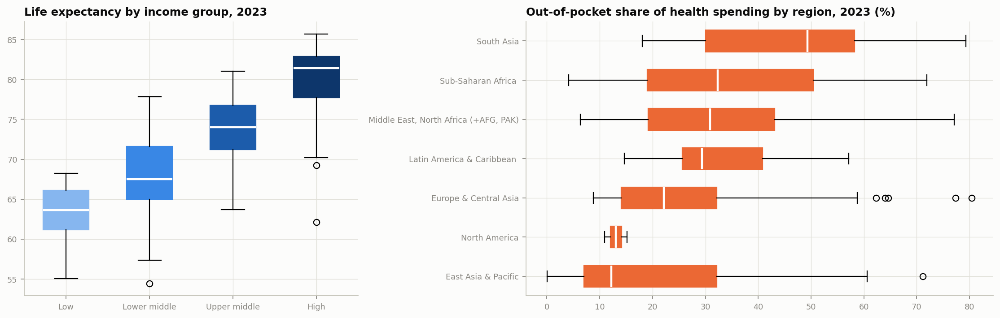
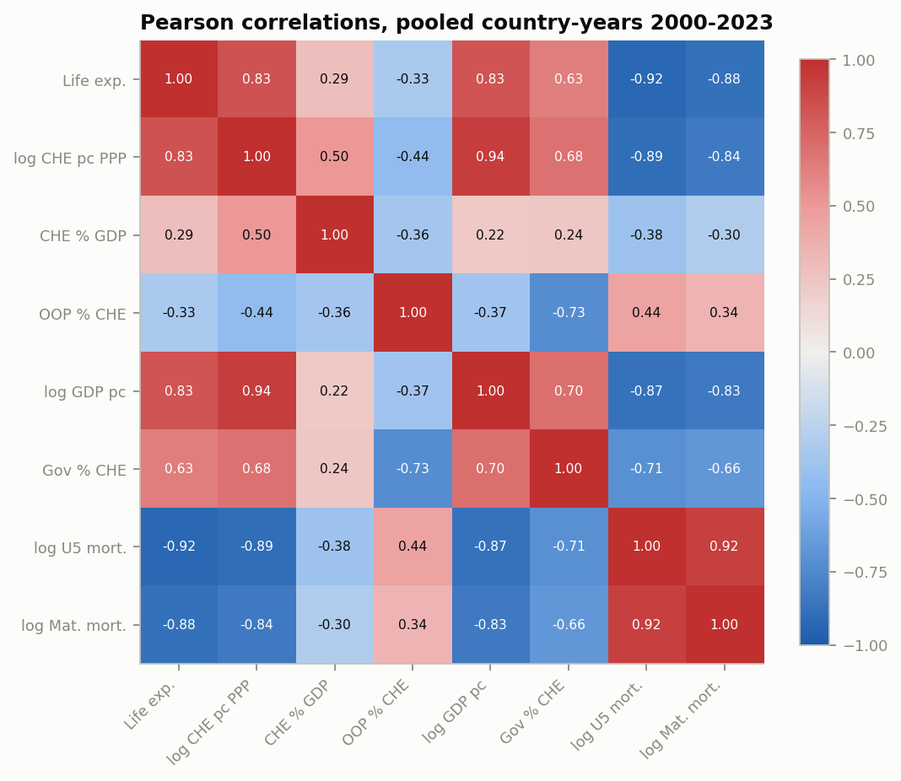
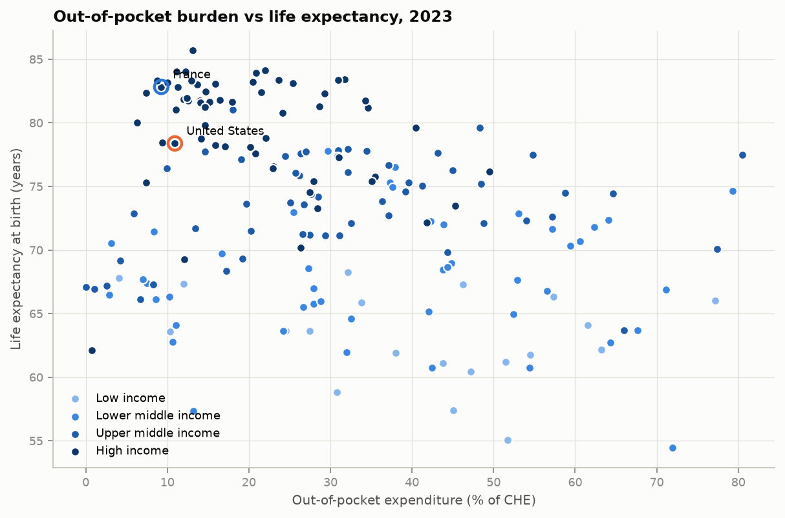

### France and the United States

| 2023 | France | United States | High-income median |
|---|---|---|---|
| Health exp. per capita (PPP $) | 6,719 | 13,473 | 3,926 |
| Health exp. % of GDP | 11.5 | 16.7 | 8.0 |
| Out-of-pocket % of CHE | 9.3 | 10.9 | 16.8 |
| Estimated OOP spending per capita (PPP $) | 622 | 1,472 | 820 |
| Domestic general government % of CHE | 67.7 | 54.0 | 73.1 |
| Life expectancy | 82.8 | 78.4 | 81.4 |
| Under-5 mortality | 4.3 | 6.5 | 4.4 |

- **The US spends twice as much as France per person but lives 4.4 years less.** The gap widened over time: it was 2.5 years in 2000.
- **France is not "free care".** Its out-of-pocket share (9.3%) is only slightly below the US share (10.9%). The World Bank/WHO GHED series used here reports domestic general government health expenditure at 67.7% of current health expenditure in France and 54.0% in the United States in 2023.
- **Similar out-of-pocket shares do not imply similar amounts.** Combining total health expenditure per capita with the out-of-pocket share gives an estimated $622 PPP per person in France and $1,472 in the United States in 2023, approximately 2.4 times as high in the US. This is a derived national average, not the exact financial burden faced by an individual household, and it does not capture the full burden of taxes, insurance premiums or deductibles.
- *Data comparability note:* France's value in the World Bank/WHO GHED series falls from 75.3% in 2022 to 67.7% in 2023, and the published value is retained here. A separate OECD/European Observatory measure reports 84.4% financed through government and compulsory schemes in 2023 [7]. These categories are not directly interchangeable, so the GHED value should be interpreted cautiously rather than manually replaced.

**Context indicators** (latest year up to 2023 with data for both countries; descriptive only, not used in any model):

| Indicator | Year | France | United States | High-income median |
|---|---|---|---|---|
| Income inequality, Gini index | 2023 | 31.8 | 41.8 | 31.8 |
| Overweight adults, BMI > 25 (%) | 2022 | 34.3 | 72.4 | 60.7 |
| Current tobacco use, adults (%) | 2023 | 33.4 | 16.4 | 21.5 |
| Population aged 65 and over (%) | 2023 | 21.7 | 17.4 | 17.3 |
| UHC service coverage index | 2023 | 82 | 88 | 83 |

Higher inequality and many more overweight adults in the US point in the expected direction. France's overweight figure is far below its neighbours in the same WHO source, so it should be treated with caution. More tobacco use and an older population in France point the other way, and the UHC index (which measures access to essential services, not insurance or financial protection) is higher in the US. A few context measures therefore cannot explain the gap.

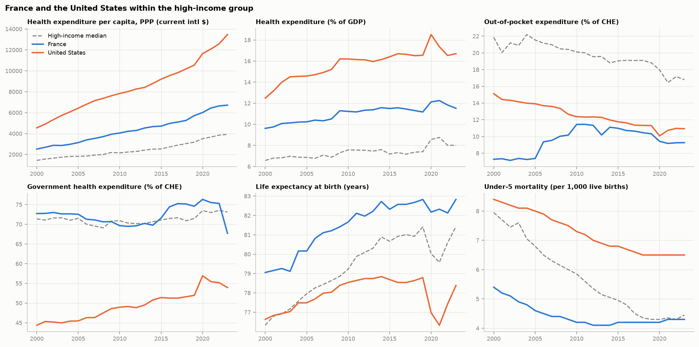

## 5. Panel regression results

Dependent variable: life expectancy at birth (years). Standard errors are clustered by country and shown in parentheses. A coefficient *b* on log spending means that a 10% spending increase is associated with about 0.095·*b* additional years.

**Methods in plain words.** *Country fixed effects* compare each country with itself over time, so traits that do not change (geography, culture) cannot bias the result. *Year fixed effects* remove what happened to all countries in the same year (new medicines, COVID-19). *Clustered standard errors* account for the fact that a country's 24 years are not independent observations. The *Hausman test* checks whether the simpler random-effects model would be valid.

|                               | (1) Pooled OLS   | (2) Country FE   | (3) Two-way FE   | (4) + GDP   | (5) + GDP + OOP   | (6) Nonlinear   |
|:------------------------------|:-----------------|:-----------------|:-----------------|:------------|:------------------|:----------------|
| log health exp. pc (PPP)      | 5.216***         | 3.823***         | 0.543            | -0.265      | -0.294            |                 |
|                               | (0.192)          | (0.221)          | (0.374)          | (0.439)     | (0.439)           |                 |
| log health exp. pc (centred)  |                  |                  |                  |             |                   | -0.997**        |
|                               |                  |                  |                  |             |                   | (0.400)         |
| log health exp. pc² (centred) |                  |                  |                  |             |                   | -0.549***       |
|                               |                  |                  |                  |             |                   | (0.083)         |
| log GDP pc (PPP)              |                  |                  |                  | 2.071***    | 2.119***          | 1.880***        |
|                               |                  |                  |                  | (0.730)     | (0.741)           | (0.640)         |
| OOP share (per 10 pp)         |                  |                  |                  |             | -0.252*           | -0.136          |
|                               |                  |                  |                  |             | (0.128)           | (0.111)         |
| Country FE / Year FE          | No / No          | Yes / No         | Yes / Yes        | Yes / Yes   | Yes / Yes         | Yes / Yes       |
| Observations (countries)      | 4,404 (186)      | 4,404 (186)      | 4,404 (186)      | 4,404 (186) | 4,404 (186)       | 4,404 (186)     |

\*p<0.1, \*\*p<0.05, \*\*\*p<0.01

**Interpretation:**

1. **Across countries, the association is strong.** In the pooled model, 10% more spending goes with about **0.50 more years** of life expectancy (model 1). This compares *different countries*. It is not the effect of one country raising its spending by 10%, because countries that spend more also differ in income, education, sanitation, diet and other ways the model does not include.
2. **Within countries over time, most of it is a common global trend.** With country fixed effects only, the coefficient is 3.82 (model 2). Once year fixed effects absorb worldwide trends it falls to 0.54 and is not significant (model 3).
3. **GDP per capita takes over the explanatory role.** Adding log GDP makes the spending coefficient indistinguishable from zero (–0.29, p = 0.50). GDP itself is significant: 2.1 years per log unit, so 10% more GDP goes with about 0.2 years (models 4–5). Spending and income rise together, and the data cannot separate them well within countries.
4. **A higher out-of-pocket share is weakly associated with lower life expectancy.** A 10-percentage-point higher share goes with about 0.25 fewer years, holding spending and GDP fixed (p = 0.05; country-cluster bootstrap 95% CI [–0.51, –0.01]). The upper end of the interval is essentially zero and changes with the random draws, so this is borderline evidence.
5. **The relationship is nonlinear, with diminishing returns** (model 6). The squared term is strongly significant. The parabola's turning point is about **$220 per capita**, but 71% of country-years lie above it, so the parabola forces a falling slope for most of the data. A flexible check with separate slopes in four spending bands agrees: the within-country slope is clearly positive only below $100 (2.8–3.5 years per log unit), close to zero at $100–500, and negative above $500. The negative slope does not mean spending shortens lives: with year fixed effects every country is compared with the global trend, and poorer countries gained life expectancy much faster, so high spenders look as if they gain less. The turning point is approximate: about $250 without COVID years and about $290 with constant-price spending.
6. **Fixed effects are preferred over random effects.** The Hausman test gives χ²(26) = 183.0, p < 0.001, so country effects are correlated with the regressors.

*Earlier studies.* The studies in our proposal (Jaba et al. 2014; Ray & Linden 2020; Balkhi et al. 2021) used cross-country panel data for 1995–2015. The proposal summarises their data and methods but not their estimates, so we do not claim that our numbers match theirs.

## 6. Robustness and heterogeneity

Each check re-estimates the two-way FE model, with and without GDP and OOP controls. Full results are in `outputs/tables/robustness_all.csv`.

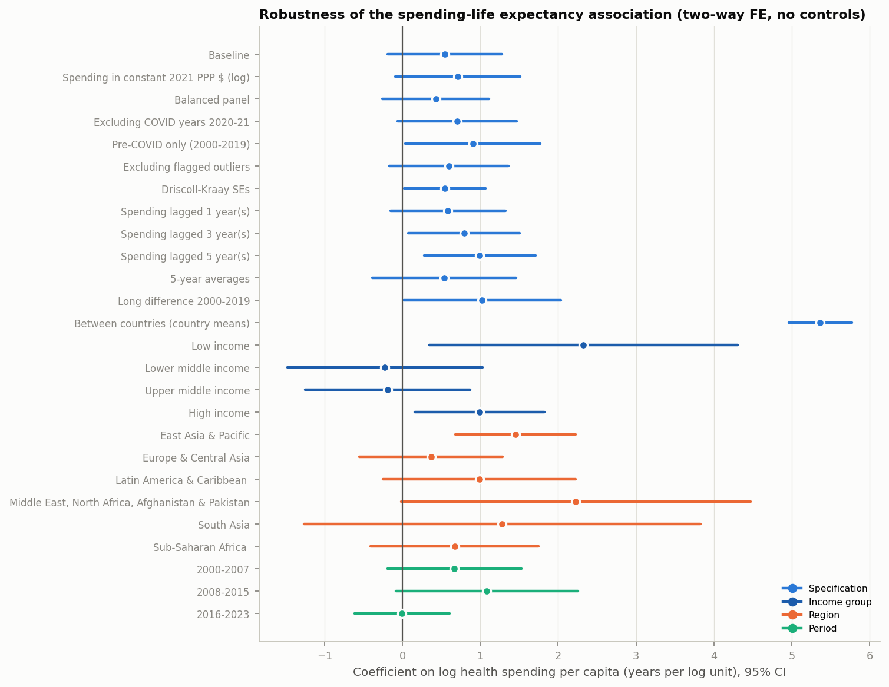

**Specification checks** (two-way FE coefficient on log spending, without controls / with GDP + OOP):

| Specification | Without controls | With GDP + OOP |
|---|---|---|
| Baseline | 0.54 | –0.29 |
| Balanced panel | 0.43 | –0.29 |
| Excluding COVID | 0.70* | –0.07 |
| Pre-COVID 2000–2019 | 0.91** | –0.00 |
| Excluding flagged outliers | 0.60 | –0.19 |
| Driscoll-Kraay SEs | 0.54** | –0.29 |
| Constant 2021 PPP $ spending | 0.71* | –0.10 |
| Spending lagged 3 years | 0.78** | 0.32 |
| Spending lagged 5 years | **0.97\*\*\*** | 0.68* |
| 5-year averages | 0.54 | –0.44 |
| Long difference 2000→2019 | 1.02** | –0.49 |
| Between countries (country means) | **5.37\*\*\*** | **3.64\*\*\*** |

\*p<0.1, \*\*p<0.05, \*\*\*p<0.01

**Alternative spending measures.** Spending as % of GDP is not significant within countries: –0.06 without controls, –0.03 with them. Log current-US$ spending gives the same picture as PPP: 0.56* without controls, –0.13 with them. Spending rebuilt in constant 2021 dollars correlates 0.988 with the main measure; the models with year fixed effects barely change, the country-FE coefficient rises from 3.8 to 4.7, and the turning point moves from $220 to about $290.

**Heterogeneity** (two-way FE, no controls):
- **Income groups.** The association is positive in low-income countries (2.33, p = 0.02) and in high-income countries (0.99, p = 0.02). It is about zero in the two middle-income groups. With controls, the high-income estimate stays marginal (1.00, p = 0.10), and the lower-middle estimate turns negative (−1.14, p = 0.09).
- **Regions.** It is strongest in East Asia & Pacific (1.45***) and in Middle East & North Africa (2.23*).
- **Periods.** It is 0.67 in 2000–07, 1.08 in 2008–15 and –0.01 in 2016–23. A period-interaction model with controls confirms a significant decline in the slope (interaction for 2016–23: –0.98, p < 0.001).

**Why did the relationship weaken?** With finer periods, the slope falls step by step from 2008–2015 onwards (–0.42 to –1.28 relative to 2000–2007), so the decline started before COVID. Median spending rose from $376 to $1,111 over the same periods. When the squared spending term is added, the 2008–2015 and 2016–2019 changes become small and not significant; what remains is in 2020–2021 (–0.48, p = 0.03) and 2022–2023 (–0.61, p = 0.006). Much of the weakening is therefore diminishing returns, and the rest is concentrated in the COVID and post-COVID years.

**Other outcomes (extension).** In two-way FE without controls, 10% more spending is associated with about 1.7% lower under-5 mortality (p < 0.001) and 1.4% lower maternal mortality (p = 0.001). Both associations become insignificant once GDP and the OOP share are controlled for.

**What is robust:**
- The large cross-country association, after controlling for GDP and OOP: between-country coefficient 3.64, p < 0.001.
- No significant within-country association with same-year spending once GDP is controlled for, in every specification check (a few subgroup splits are marginal at the 10% level, with mixed signs).
- Diminishing returns.

**What depends on choices:**
- The within-country estimate without controls (0.54) is significant with Driscoll-Kraay errors (p = 0.04) and in the pre-COVID sample, but not with country-clustered errors (p = 0.15).
- Delayed spending: a 5-year lag gives 0.97 (p = 0.007), but 0.68 (p = 0.08) with controls.

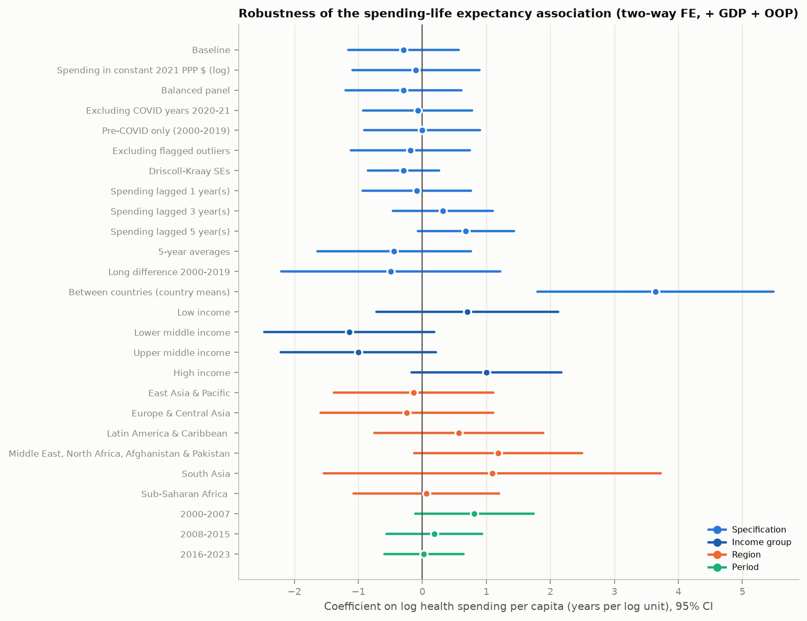

## 7. Out-of-pocket burden: bootstrap and permutation tests

Countries were split at the median out-of-pocket share, using 2016–2023 country averages (median 28.7%). The tests use 10,000 permutations and 5,000 bootstrap resamples.

| Comparison (high-OOP minus low-OOP) | Difference | 95% bootstrap CI | Permutation p |
|---|---|---|---|
| Life expectancy (raw) | **–4.1 years** | [–6.3, –2.1] | < 0.001 |
| Under-5 mortality (raw) | +17.5 per 1,000 | [9.6, 25.5] | < 0.001 |
| Life expectancy adjusted for GDP | +0.06 | [–1.0, 1.1] | 0.92 |
| Life expectancy adjusted for spending | +0.4 | [–0.7, 1.5] | 0.45 |
| Life expectancy, labels permuted within income group | –4.1 | — | 0.69 |

High-OOP countries live about 4 years less on average. That gap is **explained by national income**: it vanishes after adjusting for GDP, and it is not significant when labels are permuted within income groups. The last row shows no confidence interval because its gap is the same raw gap as in the first row; only the p-value is computed differently.

Within income groups, the gap is negative for low-income countries (–3.9 years, p = 0.07) and high-income countries (–2.1 years, p = 0.07). It is not significant for the middle-income groups (Fig. 13).

**Sensitivity.** Leaving out one country at a time, the low-income gap ranges from –4.9 to –2.7 years (–2.7 without the Central African Republic), and –3.5 without flagged country-years. The high-income gap ranges from –2.7 to –1.6 years. The direction is stable but the size depends on single countries, so this is treated as an **exploratory pattern, not a finding**. Possible explanations, not tested here: in low-income countries, direct payments may stop people from seeking care or reflect weak public systems; in high-income countries, a higher out-of-pocket share may reflect coverage gaps; in both, it may stand in for unmeasured differences such as governance or inequality.

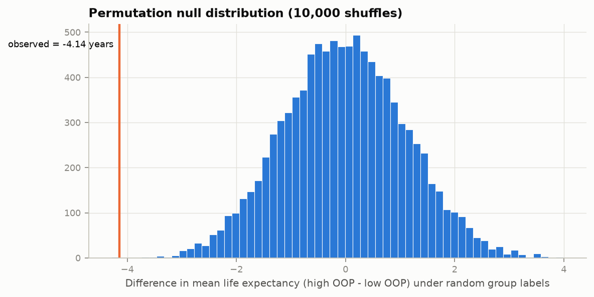
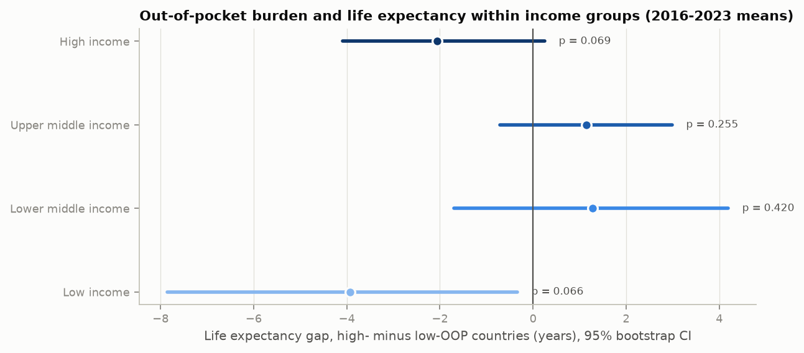

**Bootstrap CIs for cross-sectional slopes by income group.** Life expectancy was regressed on log spending using 2016–23 country means. The slope is positive in every group, and largest among high-income countries: 5.6 [3.9, 7.6], compared with 3.0 [0.3, 6.9] in low-income countries.

## 8. Who performs better or worse than expected?

A cross-sectional curve of life expectancy on log spending and its square, fitted for 2023, explains 72% of variation (76% with GDP and OOP added). Residuals show over- and under-performers (Fig. 12).

- **Over-performers.** Bangladesh (+8.6 years), Sri Lanka (+7.7), Lebanon, Vanuatu, Jordan, Kuwait, Oman, Cabo Verde, Peru and Costa Rica.
- **Under-performers.** Nauru (–14.9), Nigeria (–12.7), Lesotho (–11.3), Chad, Eswatini, South Africa and the **United States**. Several under-performers are affected by HIV/AIDS, conflict or very small-island data issues.

**How model-dependent is the US gap?**

| Model | Countries | France (years vs expected) | United States (years vs expected) | US rank |
|---|---|---|---|---|
| Spending curve, all countries | 184 | +0.5 | –8.0 | 177 |
| + GDP + OOP, all countries | 184 | +1.4 | –6.2 | 176 |
| Spending curve, high-income countries only | 62 | +0.7 | –5.4 | 59 |
| Life expectancy minus high-income median | 62 | +1.4 | –3.1 | — |

The US gap is therefore reported as **about 5 to 8 years below expectation**, depending on the model. The US spends more than any other country, so its "expected" value extends the curve beyond the data. A positive or negative residual does not prove good or bad performance, because other factors can explain a gap.

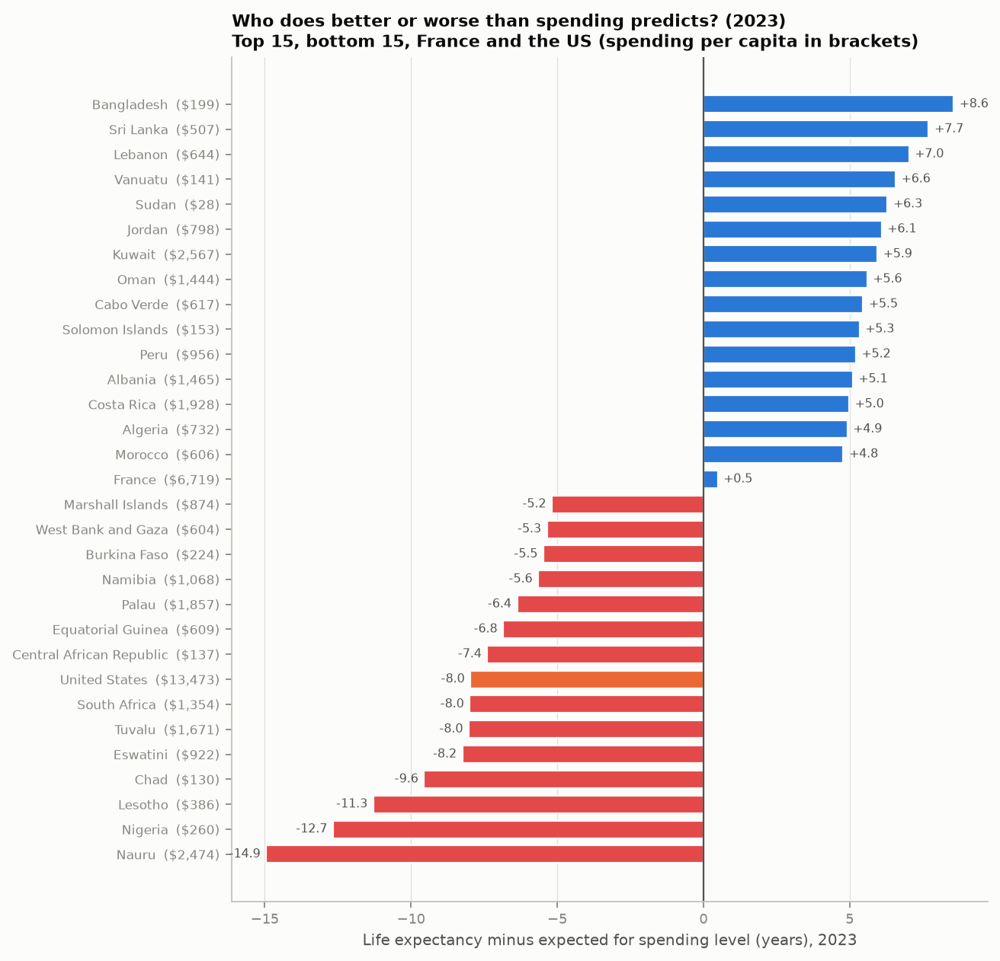

## 9. Interactive dashboard

`outputs/dashboard.html` is a single file with a choropleth map (indicator selector and year slider), a spending-vs-outcome scatter with selectable axes, trend lines for selected countries and a sortable country table. The charting library and map shapes are built into the file, so it works offline.

## 10. Conclusions

**Main findings supported by the analysis:**
1. Across countries in 2000–2023, higher health spending remains strongly associated with longer life: about 0.5 years per 10% more spending. The association survives control for GDP and out-of-pocket share in the between-country comparison.
2. Within countries, same-year spending is not associated with life expectancy once global trends and GDP are included; GDP per capita absorbs most of the within-country association.
3. Returns to spending diminish strongly: within-country gains are clearest at low spending levels.
4. The association has weakened over time. Much of this reflects diminishing returns as spending rose; the rest is concentrated in 2020–2023.
5. High out-of-pocket reliance coincides with lower life expectancy, but this mostly reflects lower national income.

**Results that depend on the model or period:** the significance of the no-controls within estimate; the lagged-spending effect once GDP is controlled for; the out-of-pocket coefficient in the panel (p = 0.05); the turning point ($220–$290); the size of the US gap (5–8 years); and the out-of-pocket gaps within low- and high-income groups.

**Possible explanations requiring further investigation:** catch-up growth of poorer countries behind the negative slope at high spending; COVID-19 and its aftermath behind the recent weakening; financial barriers or coverage gaps behind the out-of-pocket gaps; inequality and lifestyle factors behind the US–France difference.

**Potential policy implications (cautious):** more spending alone is not enough, because in high-spending countries extra spending is not associated with further gains in our data; the largest gains are associated with increases at low spending levels; and our results do not show that reducing direct payments would by itself raise life expectancy.

**Limitations:**
- This is an observational design. Fixed effects remove only time-invariant country differences and common year shocks; reverse causality and time-varying confounders remain, such as education, HIV, conflict and governance.
- Life expectancy is partly modelled or interpolated by the UN for data-poor countries, which smooths within-country variation.
- PPP conversion factors and health accounts are revised over time.
- The individual "true cost" of care, covering taxes, premiums and deductibles, is outside the scope of country-level data.

**Future work:**
- Distributed-lag or dynamic panel models for delayed effects (e.g. Ray & Linden's GMM approach).
- Separating public from private spending (the data are already collected: `gov_pct_che`, `pvt_pct_che`).
- Adding determinants such as education, HIV prevalence, conflict and inequality, and household data on financial hardship.
- Investigating flagged data points and possible breaks in series, such as the Central African Republic's life-expectancy values.

## References

[1] E. Jaba, C. Balan, and I.-B. Robu, *Procedia Economics and Finance*, 15, 108–114, 2014.
[2] D. Ray and M. Linden, *Int. J. Health Economics and Management*, 20(1), 99–119, 2020.
[3] B. Balkhi, D. Alshayban, and N. M. Alotaibi, *Frontiers in Public Health*, 8, 624962, 2021.
[4] World Bank, World Development Indicators, https://databank.worldbank.org/source/world-development-indicators (data last updated 2026-10-08).
[5] WHO Global Health Observatory, UHC service coverage index, https://www.who.int/data/gho
[6] B. Iglewicz and D. C. Hoaglin, *How to Detect and Handle Outliers*, ASQC Quality Press, 1993.
[7] OECD and European Observatory on Health Systems and Policies, *France: Country Health Profile 2025*, https://eurohealthobservatory.who.int/docs/librariesprovider3/country-health-profiles/chp2025pdf/soheu-2025-france-final-web.pdf
